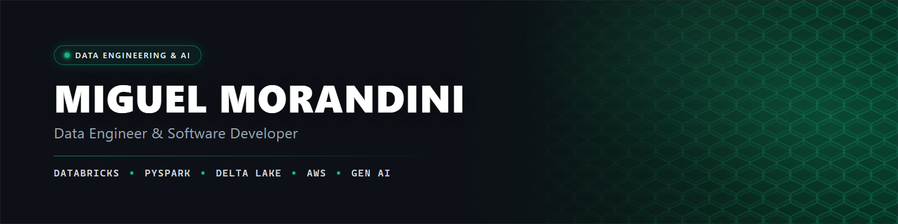
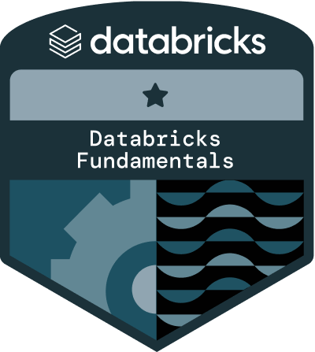
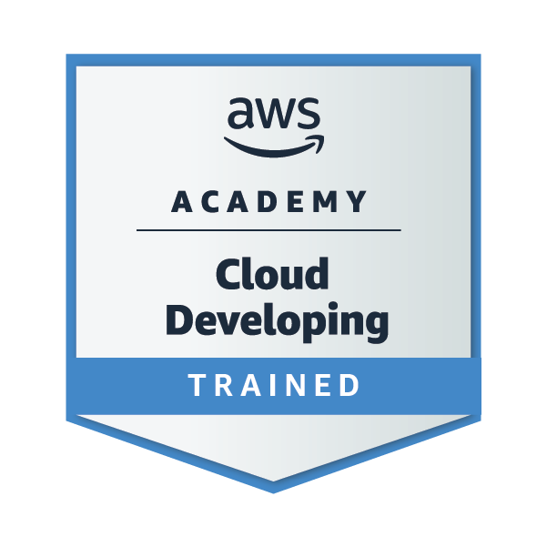
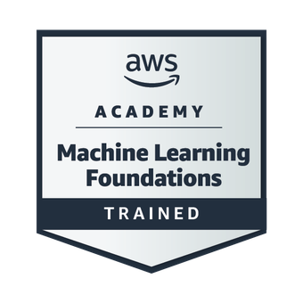

  

  

---

### 📫 How to reach me

  
  

---

### 🚀 About Me

I am an undergraduate student in **Multiplatform Software Development** at **FATEC**, focused on **Data Engineering**, **Lakehouse** architectures, and applied **Artificial Intelligence** solutions.

I work on modeling and building robust data pipelines (ETL/ELT), applying best practices of the **Medallion Architecture (Bronze, Silver, and Gold)** with **Databricks**, **Delta Lake**, and governance via **Unity Catalog**. In addition, I combine data engineering with the GenAI ecosystem, developing everything from distributed analytical applications with **PySpark** to intelligent assistants powered by **RAG (Retrieval-Augmented Generation)** and **LLMs**.

---

### 🛠 Technologies & Tools

  
  
  
  
  
  
  
  
  
  
  
  
  
  

---

### 🖊 Courses & Certifications

I continuously strive for technical excellence. Here are my courses and certifications:

<table align="center" width="100%">
  <tr>
    <!-- Item 1: Databricks Fundamentals -->
    <td align="center" width="33%">
      
        
      <b>Databricks Academy</b> 
      <a href="https://credentials.databricks.com/0319ebe6-8233-4d7b-b4a7-b8124d2fdbb1#acc.zXr8Dy9l" target="_blank">
        <b>Academy Accreditation - Databricks Fundamentals</b>
      </a>
    </td>
    <!-- Item 2: AWS Academy Cloud Developing -->
    <td align="center" width="33%">
      
        
      <b>AWS Academy Graduate</b> 
      <a href="https://www.credly.com/badges/b2dc6e15-6520-46e5-aa07-6a7d58a581e0" target="_blank">
        <b>AWS Academy: Cloud Developing</b>
      </a>
    </td>
    <!-- Item 3: AWS Academy Machine Learning Foundations -->
    <td align="center" width="33%">
      
        
      <b>AWS Academy Graduate</b> 
      <a href="https://www.credly.com/badges/dd90d770-ebb5-46e2-84d2-d2cd9dd95cb4" target="_blank">
        <b>AWS Academy: Machine Learning Foundations</b>
      </a>
    </td>
  </tr>
</table>

---

### 📌 Featured Projects

<table>
  <thead>
    <tr>
      <th align="left">Project</th>
      <th align="left">Description</th>
      <th align="left">Technologies</th>
    </tr>
  </thead>
  <tbody>
    <tr>
      <td><b><a href="https://github.com/miguelmorandini/byteword" target="_blank">ByteWord — Tech Game & dbt Analytics Pipeline</a></b></td>
      <td>Tech word-guessing game powered by Streamlit and DuckDB, featuring an end-to-end dbt Core analytical pipeline (ELT, Jinja macros, ranking marts, and data quality tests).</td>
      <td><code>Python</code> <code>dbt Core</code> <code>DuckDB</code> <code>Streamlit</code></td>
    </tr>
    <tr>
      <td><b><a href="https://github.com/miguelmorandini/lakehouse-vendas" target="_blank">Sales Lakehouse with Databricks</a></b></td>
      <td>Complete Medallion Architecture (Bronze ➔ Silver ➔ Gold), featuring distributed processing with Spark, Delta Lake, and governance with Unity Catalog.</td>
      <td><code>Databricks</code> <code>PySpark</code> <code>Delta Lake</code> <code>SQL</code></td>
    </tr>
    <tr>
      <td><b><a href="https://github.com/miguelmorandini/chat-pdf-rag" target="_blank">Chat with PDF via RAG & Gemini</a></b></td>
      <td>Interactive document Q&A application using Retrieval-Augmented Generation (RAG) and the Google Gemini API.</td>
      <td><code>Python</code> <code>Gemini API</code> <code>LangChain</code> <code>VectorDB</code></td>
    </tr>
    <tr>
      <td><b><a href="https://github.com/miguelmorandini/airpong" target="_blank">AirPong — Computer Vision Game</a></b></td>
      <td>Classic Pong game controlled in real time via hand gesture tracking through the webcam.</td>
      <td><code>Python</code> <code>OpenCV</code> <code>MediaPipe</code></td>
    </tr>
  </tbody>
</table>
